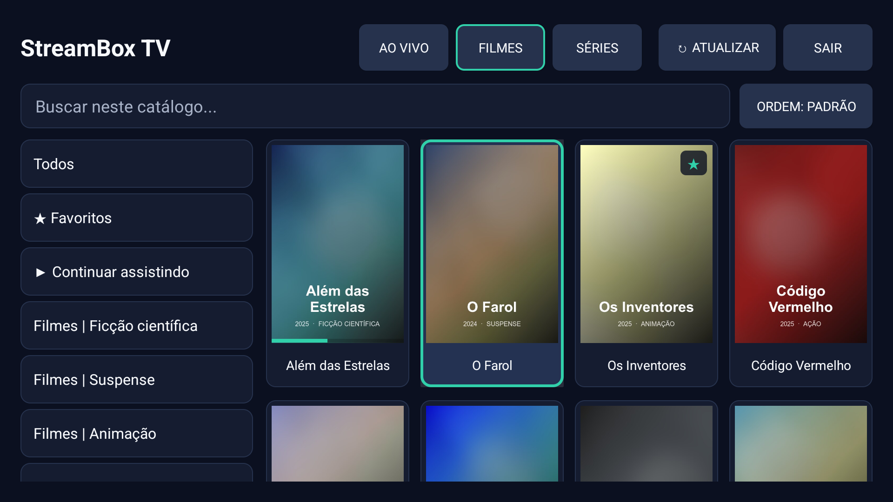
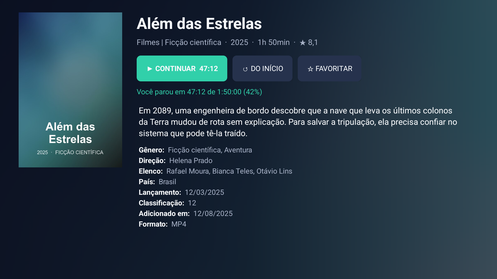
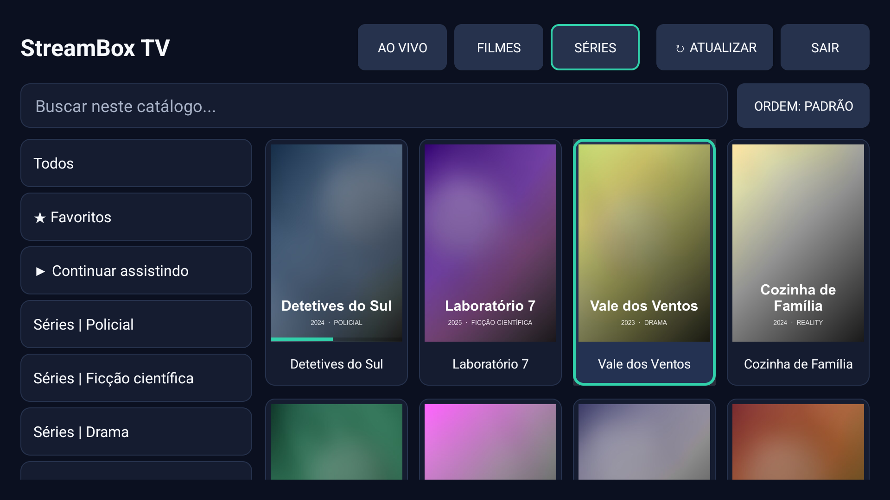
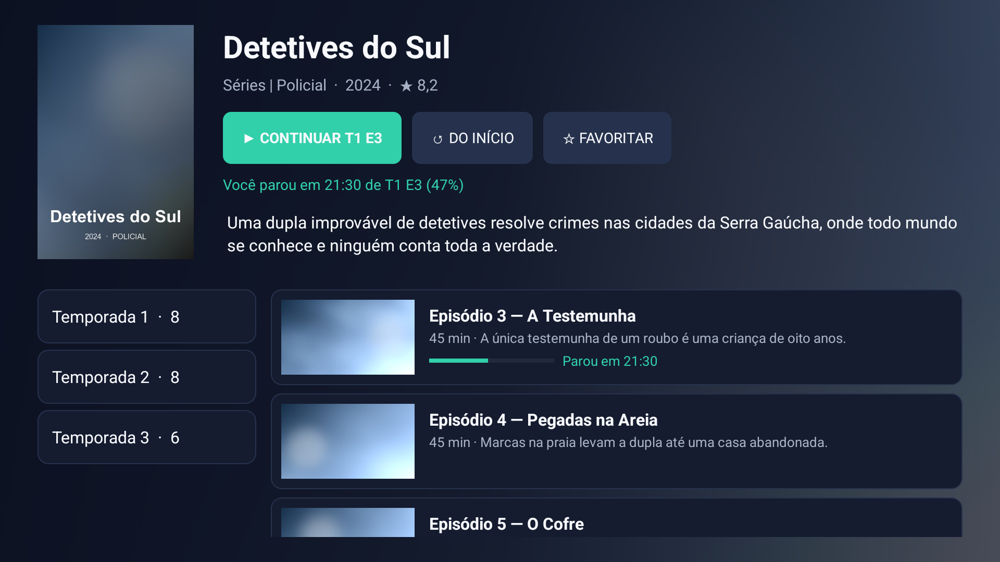
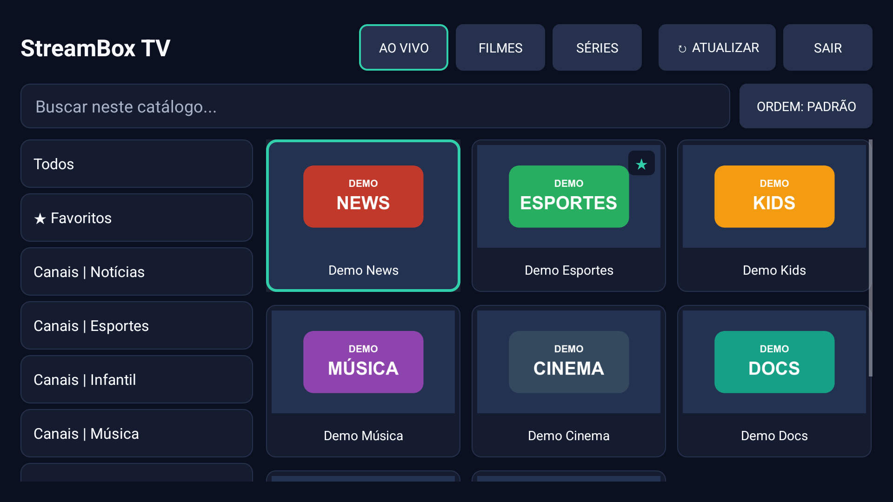
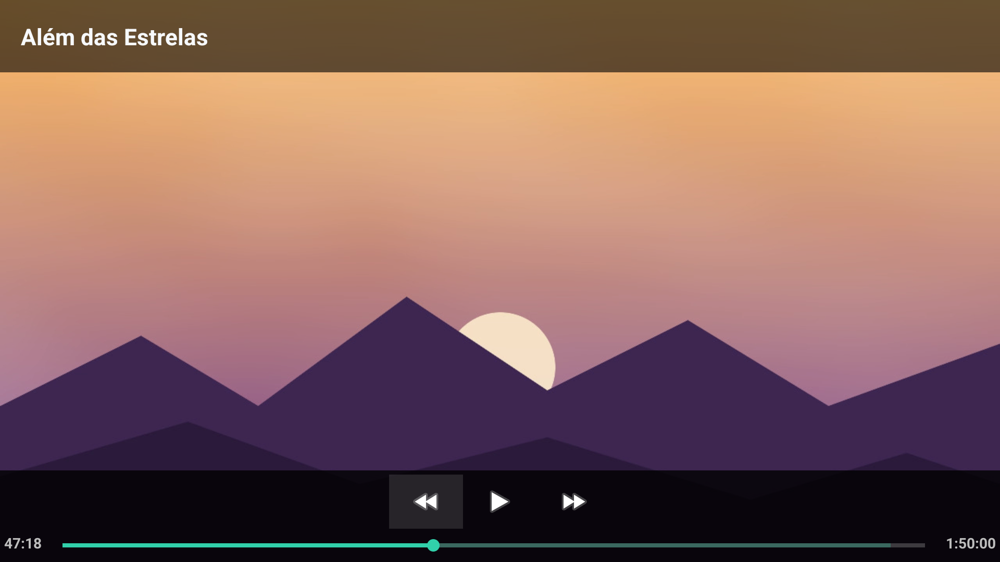
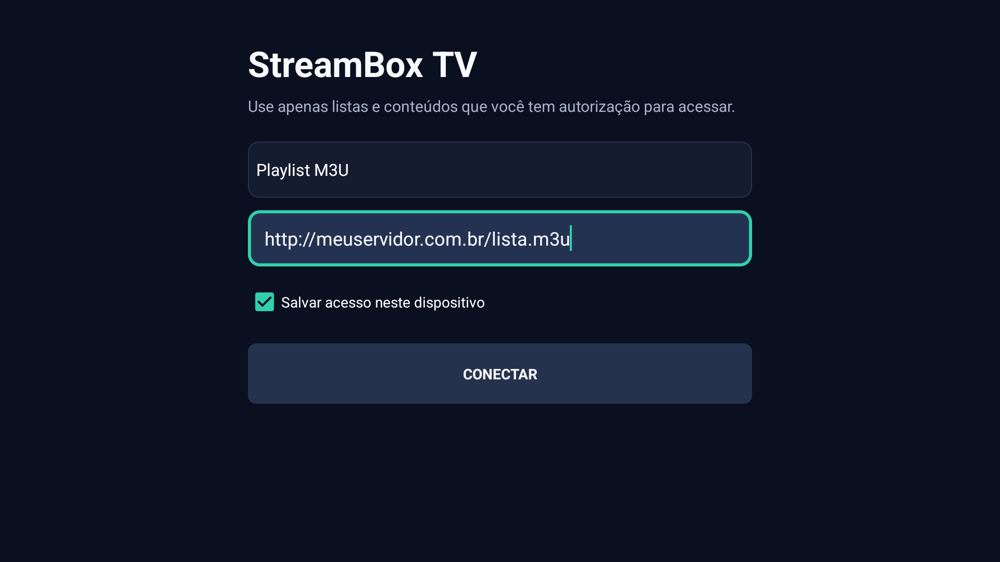

# StreamBox TV

Reprodutor para **Fire TV** e **Android TV / Google TV** de listas **M3U** e contas **Xtream Codes**.

O app é só um reprodutor: ele **não fornece** listas, canais nem conteúdo. Use apenas listas e conteúdos que você possui ou tem autorização para acessar.

**Link de download (sempre a versão mais recente):**

```
https://github.com/andrefantinato/streambox-tv-download/releases/latest/download/app-debug.apk
```

---

## Telas

> Imagens feitas com um catálogo **fictício** de demonstração: títulos, capas e canais foram inventados. O app não vem com nenhum conteúdo.

| Filmes | Tela do filme |
|---|---|
|  |  |

| Séries | Temporadas e episódios |
|---|---|
|  |  |

| Canais ao vivo | Player (o título aparece só ao pausar) |
|---|---|
|  |  |

---

## Sumário

- [Telas](#telas)
- [Compatibilidade](#compatibilidade)
- [Instalar no Fire TV (Fire Stick) com o Downloader](#instalar-no-fire-tv-fire-stick-com-o-downloader)
- [Instalar em TVs Android / Google TV](#instalar-em-tvs-android--google-tv)
- [Como usar](#como-usar)
- [Atualizar para uma nova versão](#atualizar-para-uma-nova-versão)
- [Problemas comuns](#problemas-comuns)

---

## Compatibilidade

O StreamBox TV é um app **Android** (arquivo `.apk`). Ele funciona em aparelhos que rodam Android 6.0 ou mais recente:

| Aparelho | Funciona? |
|---|---|
| Fire TV Stick, Fire TV Stick Lite, 4K, 4K Max, Fire TV Cube e TVs com Fire TV integrada (Fire OS 6 ou mais recente) | ✅ Sim |
| TVs com **Android TV** ou **Google TV**: Sony, Philips, TCL, Xiaomi, Toshiba, Hisense com Google TV, entre outras | ✅ Sim |
| Chromecast com Google TV, Google TV Streamer, Xiaomi Mi Box / TV Stick, Nvidia Shield e TV boxes Android | ✅ Sim |
| Celulares e tablets Android | ✅ Funciona, mas a interface foi feita para TV |
| **LG** (webOS) | ❌ Não |
| **Samsung** (Tizen) | ❌ Não |
| Roku, Apple TV | ❌ Não |
| Fire TV Stick 4K Select (sistema Vega OS) | ❌ Não, porque ele não instala apps Android |
| Fire TV muito antigos, com Fire OS 5 | ❌ Não, porque o app exige Android 6.0 ou mais recente |

**Tem uma TV LG ou Samsung?** Esses sistemas não instalam arquivos `.apk`. A solução é ligar na entrada HDMI da TV um **Fire TV Stick** ou um aparelho com **Google TV** (por exemplo, o Chromecast com Google TV) e instalar o app nele.

> Para ver a versão do Fire OS: **Configurações → Minha Fire TV → Sobre**.

---

## Instalar no Fire TV (Fire Stick) com o Downloader

### 1. Instale o app Downloader

1. Na tela inicial do Fire TV, abra a **Pesquisa** (ícone de lupa) ou vá em **Encontrar → Pesquisar**.
2. Digite **Downloader**.
3. Escolha o app **Downloader**, da AFTVnews (ícone laranja com uma seta).
4. Selecione **Obter** (ou **Baixar**) e aguarde a instalação.

### 2. Ative as opções do desenvolvedor

1. Vá em **Configurações → Minha Fire TV → Sobre**.
2. Selecione o nome do aparelho (por exemplo, **Fire TV Stick**) e aperte **OK 7 vezes seguidas**.
3. Aparece a mensagem *"Você agora é um desenvolvedor"*. Se a mensagem disser que você já é um desenvolvedor, pode seguir.
4. Volte uma tela. Agora existe o item **Opções do desenvolvedor** em **Minha Fire TV**.

### 3. Permita que o Downloader instale apps

1. Vá em **Configurações → Minha Fire TV → Opções do desenvolvedor**.
2. Abra **Instalar apps desconhecidos**.
3. Selecione **Downloader** e deixe como **Ativado**.

> Em modelos mais antigos, a opção aparece como **Apps de fontes desconhecidas**. Basta ativá-la.

### 4. Baixe e instale o StreamBox TV

1. Abra o **Downloader**. Na primeira vez, toque em **Permitir** quando ele pedir acesso aos arquivos e feche os avisos iniciais.
2. Na aba **Home**, selecione o campo **"Enter a URL or Search Term"** (*Digite uma URL*).
3. Digite o endereço abaixo, exatamente como está:

   ```
   https://github.com/andrefantinato/streambox-tv-download/releases/latest/download/app-debug.apk
   ```

4. Selecione **Go** e aguarde o download. O arquivo é pequeno e baixa em poucos segundos.
5. A tela de instalação abre sozinha. Selecione **Instalar**.
6. Ao terminar, selecione **Concluído**. O Downloader pergunta se quer apagar o arquivo baixado: escolha **Delete** e depois **Delete** de novo para liberar espaço. O app continua instalado.

### 5. Abra o app

O StreamBox TV aparece em **Seus apps e canais**. Para chegar lá, segure o botão **Home** do controle e escolha **Apps**, ou use o último ícone da fileira de apps na tela inicial.

> Dica: para deixar o app na tela inicial, selecione o ícone dele, aperte o botão **☰ (Menu)** do controle e escolha **Mover**.

---

## Instalar em TVs Android / Google TV

### Opção A: com o Downloader (recomendado)

**1. Instale o Downloader.** Abra a **Google Play Store** da TV, pesquise **Downloader** e instale o app da AFTVnews.

**2. Ative o modo desenvolvedor.** Este passo só é necessário no Google TV; nas Android TV mais antigas, pule para o passo 3.

1. Vá em **Configurações → Sistema → Sobre**.
2. Desça até **Build do SO do Android TV** e aperte **OK 7 vezes seguidas**, até aparecer *"Você agora é um desenvolvedor"*.

**3. Permita fontes desconhecidas.**

- **Google TV:** **Configurações → Apps → Segurança e restrições → Fontes desconhecidas** e ative o **Downloader**.
- **Android TV:** **Configurações → Preferências do dispositivo → Segurança e restrições → Fontes desconhecidas** e ative o **Downloader**.

> Os nomes dos menus mudam um pouco de fabricante para fabricante. Se não encontrar, procure por **"Fontes desconhecidas"** ou **"Instalar apps desconhecidos"** nas configurações.

**4. Baixe e instale.** Abra o Downloader, digite o mesmo endereço do Fire TV e siga a instalação:

```
https://github.com/andrefantinato/streambox-tv-download/releases/latest/download/app-debug.apk
```

**5. Abra o app.** No Google TV, apps instalados assim ficam em **Apps → Ver todos os apps**. Na Android TV, ficam na fileira de apps da tela inicial.

### Opção B: com um pendrive

1. No computador, baixe o arquivo pelo link acima e copie o `app-debug.apk` para um pendrive.
2. Instale na TV um gerenciador de arquivos pela Play Store, como o **File Commander** ou o **X-plore**.
3. Permita que esse gerenciador instale apps, seguindo o passo 3 da Opção A com o gerenciador no lugar do Downloader.
4. Conecte o pendrive na TV, abra o arquivo `app-debug.apk` pelo gerenciador e selecione **Instalar**.

---

## Como usar

### Primeiro acesso

1. No primeiro campo, escolha o tipo de acesso:
   - **Playlist M3U**, se você tem um link de lista (`http://.../lista.m3u` ou `.../m3u_plus`);
   - **Xtream Codes**, se você tem servidor, usuário e senha.
2. Preencha os dados. Para digitar, selecione o campo e use o teclado da tela.
3. Deixe marcado **Salvar acesso neste dispositivo** para não precisar digitar de novo.
4. Selecione **CONECTAR**.

O primeiro carregamento de uma lista grande pode levar alguns segundos. Depois disso, a lista fica guardada no aparelho e abre bem mais rápido.



### Tela principal

| Item | O que faz |
|---|---|
| **AO VIVO / FILMES / SÉRIES** | Troca o tipo de conteúdo. |
| **Categorias** (coluna da esquerda) | Filtra pelo grupo da lista. |
| **★ Favoritos** | Mostra os títulos que você favoritou. |
| **▶ Continuar assistindo** | Mostra os filmes e séries que você começou a ver (só em Filmes e Séries). |
| **Buscar neste catálogo...** | Procura pelo nome. |
| **ORDEM** | Ordena por padrão da lista, nome (A → Z ou Z → A) ou data de adição (mais antigos ou mais novos primeiro). |
| **↻ ATUALIZAR** | Baixa a lista de novo, para ver os conteúdos novos. |
| **SAIR** | Desconecta e apaga o acesso salvo. |

### Controle remoto

| Ação | Como fazer |
|---|---|
| Abrir um título | Selecione e aperte **OK**. |
| **Favoritar** ou desfavoritar | **Segure OK** sobre o título, ou use **☆ FAVORITAR** na tela do título. |
| Pausar e continuar o vídeo | Aperte **OK** ou **Play/Pause**. O nome do título aparece no topo enquanto o vídeo está pausado. |
| Sair do vídeo | Aperte **Voltar**. Em filmes e séries, o ponto onde você parou fica salvo. |

### Filmes e séries

Ao abrir um filme ou série, aparece uma tela com capa, sinopse, ano, duração, nota, gênero, direção e elenco, quando o servidor fornece essas informações.

- **▶ ASSISTIR / ▶ CONTINUAR**: começa o título ou continua de onde você parou.
- **↺ DO INÍCIO**: recomeça do zero.
- Em séries, escolha a **temporada** à esquerda e o **episódio** à direita. Os episódios vistos aparecem como **✓ Assistido**. Ao terminar um episódio, o botão principal já sugere o próximo.

### A lista fica guardada

Para abrir rápido e não sobrecarregar o servidor, a lista baixada é reaproveitada por **até 24 horas**. Depois disso, ela é baixada de novo ao conectar. Para atualizar na hora, use **↻ ATUALIZAR**. Se o servidor estiver fora do ar, o app continua funcionando com a última lista baixada.

---

## Atualizar para uma nova versão

Repita o **passo 4** da instalação usando o mesmo link. Ele sempre aponta para a versão mais recente. Selecione **Instalar** quando o sistema perguntar se deseja atualizar.

Favoritos, progresso e o acesso salvo são mantidos.

---

## Problemas comuns

| Mensagem ou problema | O que fazer |
|---|---|
| **Instalação bloqueada** ou o Downloader não consegue instalar | Confira o passo 3: o Downloader precisa estar autorizado a instalar apps. |
| O Downloader abre uma **página** em vez de baixar o arquivo | Confira se digitou o link exatamente como está, terminando em `app-debug.apk`. |
| **App não instalado** ao atualizar | Desinstale a versão antiga e instale de novo. Nesse caso, favoritos e progresso são perdidos. |
| Não acho o app depois de instalar | Fire TV: **Seus apps e canais**. Google TV: **Apps → Ver todos os apps**. |
| **A URL não retornou uma playlist M3U válida** | O link não é uma lista M3U. Confira o endereço com quem fornece a lista. |
| **Falha HTTP 403** | O servidor da lista recusou o acesso. Pode ser um bloqueio temporário por excesso de acessos ou um problema na conta. Aguarde algumas horas ou fale com quem fornece a lista. |
| **Falha HTTP 404** | O endereço da lista não existe. Confira o link. |
| **Servidor, usuário ou senha inválidos** | Confira os dados do Xtream Codes. |
| **Não foi possível reproduzir este conteúdo** | O canal está fora do ar ou usa um formato que o player do aparelho não suporta. Tente outro canal ou outra versão do mesmo título (por exemplo, sem "4K" ou "H265"). |

### Desinstalar

- **Fire TV:** **Configurações → Aplicativos → Gerenciar aplicativos instalados → StreamBox TV → Desinstalar**.
- **Google TV / Android TV:** **Configurações → Apps → StreamBox TV → Desinstalar**.
